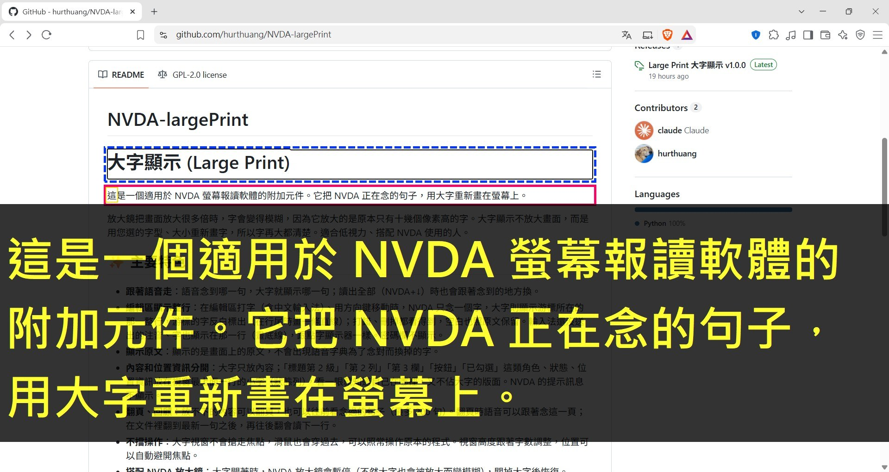

# NVDA-largePrint
# Large Print

[中文說明](README.md)

An add-on for the NVDA screen reader. It redraws what NVDA is speaking in large print.

When a magnifier zooms in a lot, text gets blurry because it is enlarging characters that were only a dozen or so pixels tall. Large Print does not zoom the screen. It draws the text again, in the font and size you choose, so it stays sharp however big it gets. It is meant for people with low vision who use NVDA.

## Features

* **Follows speech**: the large print shows the sentence NVDA is speaking. During say all (NVDA+Down arrow) it moves along with the speech.
* **Whole line in edit fields**: when you type (including with an input method) or move with the arrow keys, NVDA speaks only one character, but Large Print shows the whole line the caret is on. The character at the caret is highlighted; at the end of a line a caret bar is drawn. Typos, deletions and spaces are shown as they are in the text. Characters that an input method has not committed yet are shown underlined in that line, the same way a braille display shows them. Password fields are not shown.
* **IME candidates**: while you choose a candidate in a Chinese input method, the line from your document stays on top and the next line lists the candidates on the current page with their numbers. The selected candidate is highlighted, and the list scrolls with it.
* **Original text**: it shows the text as it appears on screen, not the words a speech dictionary replaced so that the synthesizer pronounces them correctly.
* **Content and position information kept apart**: the large print holds only the content. Information such as "heading level 2", "row 2", "column 3", "button" or "checked" goes in a line of small text at the top of the window (the status line), so you can see where you are without it taking up space. NVDA's own messages are not shown.
* **Page through and review**: content that does not fit can be paged through, and you can go back to earlier sentences (up to 200). The page can be read aloud as you turn to it. In a document, moving past the newest sentence reads the next line.
* **Stays out of the way**: the window never takes the focus and mouse clicks pass through it, so you keep using your programs as usual. Its height follows the amount of text, and it can move itself away from the focus.
* **Mouse tracking**: when NVDA's mouse tracking is on (NVDA+M), whatever the mouse points at is shown in large print too, even while the focus is in an edit field. When the mouse moves into the large print window, the window moves to the other half of the screen so it does not cover what you are pointing at.
* **Works with NVDA's magnifier**: while Large Print is shown, NVDA's magnifier is paused (otherwise it would magnify the large print and blur it again). It resumes when Large Print is hidden.
* **Zhuyin for Chinese characters** (a setting): Zhuyin (Bopomofo) is drawn vertically to the right of each character, as in Taiwanese school books. For characters with several readings, the reading is chosen from the context. See *Zhuyin* below.

## Requirements

* NVDA 2026.1 or later; tested with 2026.3.
* The interface is in English and Traditional Chinese (it follows NVDA's language).

## Input gestures

These can be changed in NVDA's **Input gestures** dialog (category: `Large Print`).

* `NVDA + Shift + Z`: show or hide Large Print

The following keys work only while Large Print is shown. When it is hidden, they keep their usual NVDA functions (such as the magnifier's).

* `NVDA + Shift + Page Down`: next (next page; on the last page, the next sentence)
* `NVDA + Shift + Page Up`: previous (previous page; on the first page, the previous sentence)
* `NVDA + Shift + =`: bigger text
* `NVDA + Shift + -`: smaller text

While Large Print is shown, pressing the NVDA key or Shift on its own does not stop or pause speech. Press Control to stop speech.

## Settings

NVDA menu → Preferences → Settings → **Large Print**:

1. **Position**:
   * **Automatic** (default): at the top when the focus is in the lower half of the screen, and at the bottom otherwise.
   * **Follow the focus**: just below the focused line, or above it if there is no room below.
   * **Always at the top**, **Always at the bottom**.
2. **Maximum height (percent of the screen)**: the window never grows taller than this; longer text is split into pages.
3. **Text size (pixels)**.
4. **Font**: Microsoft JhengHei by default. **Bold** can be turned on.
   * **Show Zhuyin (Bopomofo) beside Chinese characters** (off by default): the large print uses the bundled Zhuyin font (the status line does not).
5. **Colors**: yellow on black (default), white on black, green on black, black on white, black on yellow, white on blue.
   * **Opacity**: 50 to 100 (default 80; 100 is fully opaque). Lower values let you see the screen behind the window; the text fades along with the background.
6. **Heading levels, table rows and columns and other position information**: in the status line (default), hidden, or with the content.
7. **While choosing IME candidates, show**:
   * **Candidates and their numbers** (default): the document line on top and, below it, the candidates on this page, such as "1家　2加　3佳…". The selected one is highlighted, and the list scrolls with it when it does not fit on one line. The first related word of the selected candidate (such as "加油的加") appears in small text in the status line.
   * **Candidates and related words**: the second line shows what NVDA speaks (such as "2 加油的加，加工，參加…").
8. **Read the page aloud when turning pages** (on by default).
9. **Show Large Print when NVDA starts** (off by default).
10. **Check for updates** button.

## Zhuyin

With **Show Zhuyin (Bopomofo) beside Chinese characters** on, the large print uses the Bpmf Iansui font, which draws Zhuyin to the right of each character. The font is bundled with the add-on and is only loaded for NVDA; nothing is installed.

* For characters with several readings, the reading comes from a list of words based on the Ministry of Education's polyphone standard, then from word segmentation with the McBopomofo dictionary, and otherwise the most common reading is used.
* The marking follows Taiwanese primary school books: 一 is marked with its changed tone (一條, 一大張), 不 with its original tone; 和 as a conjunction is ㄏㄢˋ; 得 after a verb (覺得, 跑得快) and 地 in 慢慢地 are neutral tone.
* Checked against about 370 polyphones in a grade 2 Chinese textbook (Nan I, first semester): about 98% correct. Some readings will still be wrong; please report them on GitHub Issues.

## Updates

After NVDA starts, the add-on checks GitHub once in the background for a newer version. It asks whether to download and install only when there is one, and otherwise says nothing. You can also check by hand with the **Check for updates** button in the settings (you can assign a gesture to it in Input gestures). If you installed the add-on from the NVDA Add-on Store, updates are left to the store and the add-on does not check by itself.

## Known limitations

* Only the primary display is used.
* Windows Magnifier is not paused; if it is on, it magnifies the large print too.
* If you go back to an earlier sentence during say all, say all does not continue from there.

## License

GPL v2. See [LICENSE](LICENSE).

The Zhuyin font and data (`globalPlugins/largePrint/zhuyin/`, see README.txt there):

* Bpmf Iansui by ButTaiwan ([bpmfvs](https://github.com/ButTaiwan/bpmfvs)): SIL Open Font License 1.1
* Reading table and polyphone word list: from bpmfvs, Apache License 2.0
* Dictionary: from [McBopomofo](https://github.com/openvanilla/McBopomofo), MIT License
