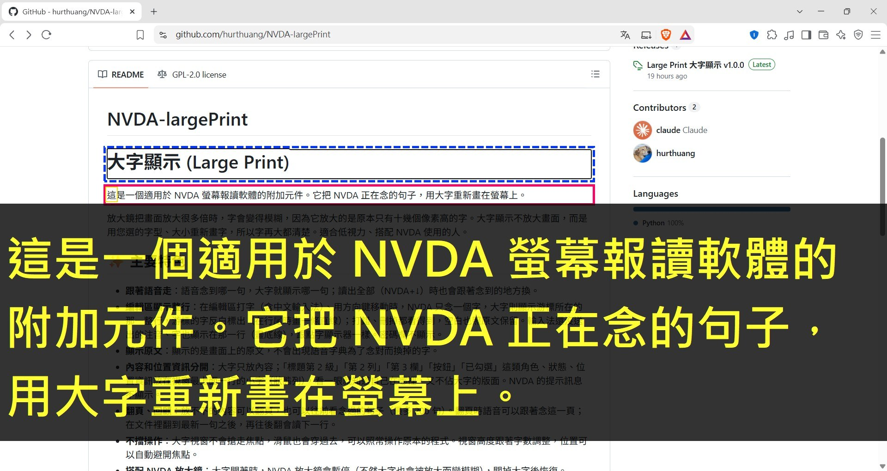
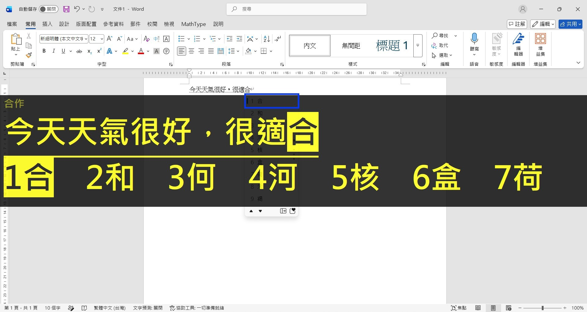
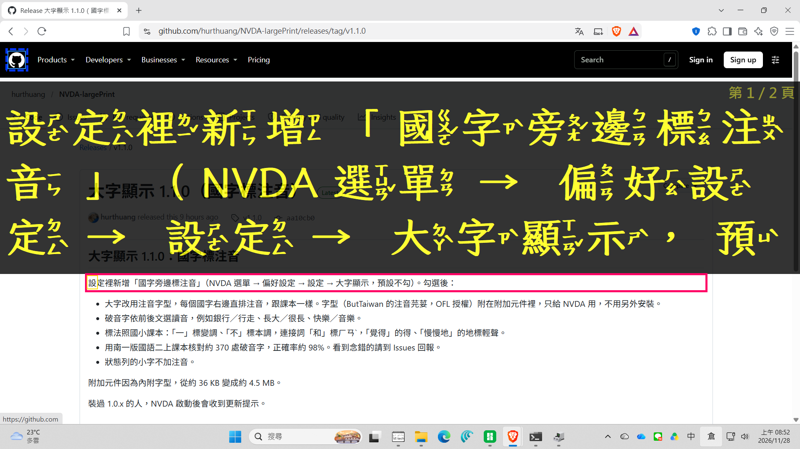

# NVDA-largePrint
# 大字顯示 (Large Print)

[English](README.en.md)

這是一個適用於 NVDA 螢幕報讀軟體的附加元件。它把 NVDA 正在念的句子，用大字重新畫在螢幕上。

放大鏡把畫面放大很多倍時，字會變得模糊，因為它放大的是原本只有十幾個像素高的字。大字顯示不放大畫面，而是用您選的字型、大小重新畫字，所以字再大都清楚。適合低視力、搭配 NVDA 使用的人。

## ✨ 主要特色

* **跟著語音走**：語音念到哪一句，大字就顯示哪一句；讀出全部（NVDA+↓）時也會跟著念到的地方換。
* **編輯區顯示整行**：在編輯區打字（含中文輸入法）、用方向鍵移動時，NVDA 只念一個字，大字則顯示游標所在的那一整行，游標的字反白標出（在行尾時畫一條直線）；打錯、刪掉都看得到，空白也照原文保留。輸入法還沒送出的注音、字也顯示在那一行（畫底線），跟點字顯示器一樣。密碼欄不顯示。

* **顯示原文**：顯示的是畫面上的原文，不會出現語音字典為了念對而換掉的字。
* **內容和位置資訊分開**：大字只放內容；「標題第 2 級」「第 2 列」「第 3 欄」「按鈕」「已勾選」這類角色、狀態、位置資訊放在視窗最上面一行的小字（狀態列），看一眼就知道自己在哪裡，又不佔大字的版面。NVDA 的提示訊息不顯示。
* **翻頁、回顧**：放不下的內容可以翻頁，也可以往前看念過的句子（最多 200 句）。翻頁時語音可以跟著念這一頁；在文件裡翻到最新一句之後，再往後翻會讀下一行。
* **不擋操作**：大字視窗不會搶走焦點，滑鼠也會穿過去，可以照常操作原本的程式。視窗高度跟著字數調整，位置可以自動避開焦點。
* **跟隨滑鼠朗讀**：開了 NVDA 的跟隨滑鼠朗讀（NVDA+M）時，滑鼠指到的項目也用大字顯示（焦點在編輯區也一樣）；滑鼠移進大字視窗的範圍，視窗會換到螢幕的另一半，不擋住滑鼠指的地方。
* **搭配 NVDA 放大鏡**：大字開著時，NVDA 放大鏡會暫停（不然大字也會被放大而變模糊），關掉大字後恢復。
* **國字標注音**（設定裡勾選）：國字右邊直排注音，跟課本一樣；破音字依前後文選讀音（銀行／行走、長大／很長）。見下面〈注音〉。

## 🚀 系統需求

* NVDA 2026.1 或更新版本，已於 2026.3 測試
* 介面有中文、英文（跟著 NVDA 的語言）

## ⌨️ 預設快捷鍵

可以在 NVDA 的 **「輸入手勢」** 對話框中（分類：`大字顯示`）修改。

* `NVDA + Shift + Z`：開關大字顯示

以下按鍵只在大字開著時有作用（大字關掉時，照原本 NVDA 放大鏡等功能的用法）：

* `NVDA + Shift + PageDown`：往後（下一頁；到最後一頁就到下一句）
* `NVDA + Shift + PageUp`：往前（上一頁；到第一頁就到上一句）
* `NVDA + Shift + =`：字放大
* `NVDA + Shift + -`：字縮小

大字開著時，單按 NVDA 鍵或 Shift 不會停止或暫停語音，要停止語音請按 Ctrl。

## ⚙️ 設定選項說明

在 NVDA 選單 → 偏好設定 → 設定 → **「大字顯示」**：

1. **位置**：
   * **自動**（預設）：焦點在螢幕下半部就放上方，反過來就放下方。
   * **跟著焦點浮動**：放在焦點那一行的正下方，下面放不下就放上方。
   * **固定在上方**、**固定在下方**。
2. **最高佔螢幕的百分比**：視窗高度的上限，放不下就分頁。
3. **字的大小**：以像素為單位。
4. **字型**：預設微軟正黑體；可勾選**粗體**。
   * **國字旁邊標注音**（預設不勾）：大字改用附的注音字型（狀態列的小字照舊）。
5. **配色**：黑底黃字（預設）、黑底白字、黑底綠字、白底黑字、黃底黑字、藍底白字。
   * **不透明度**：50～100（預設 80；100＝不透明）。調低可以透過大字視窗看到後面的畫面；字也會一起變淡。
6. **標題層級、表格欄列等位置資訊**：放在狀態列（預設）、不顯示、跟內容一起顯示。
7. **輸入法選字時顯示**：
   * **候選字和編號**（預設）：上面是文件那一行，下面一行列出這一頁的候選字「1家　2加　3佳…」，選到的反白，一行放不下時跟著選到的字捲動；選到的字的第一個相關詞（例如「加油的加」）用小字放在狀態列。
   * **候選字和相關詞**：下面一行照 NVDA 念的顯示（例如「2 加油的加，加工，參加…」）。
8. **翻頁時語音跟著念這一頁**（預設勾選）。
9. **NVDA 啟動時開啟大字顯示**（預設不勾）。
10. **檢查更新** 按鈕。

## 注音

勾選「國字旁邊標注音」後，大字用注音芫荽字型顯示，每個字右邊直排注音。字型附在附加元件裡，只給 NVDA 用，不用另外安裝。

* 破音字依前後文選讀音：先查照《國語一字多音審訂表》整理的破音詞表，再用小麥注音的詞庫斷詞判斷，都沒有就用最常用的讀音。
* 標法跟國小課本一樣：「一」標變調（一條、一大張），「不」標本調；連接詞「和」標ㄏㄢˋ；「覺得」「跑得快」的得、「慢慢地」的地標輕聲。
* 用南一版國語二上課本核對過約 370 處破音字，正確率約 98%。還是會有念錯的時候，看到請回報（GitHub Issues），我們再補規則。

## 🔄 更新

NVDA 啟動後會在背景檢查一次 GitHub 上有沒有新版本，有新版才會詢問是否下載安裝，沒有就不出聲。也可以在設定的「檢查更新」按鈕手動檢查（「輸入手勢」裡也可以自訂檢查更新的按鍵）。從 NVDA 附加元件商店安裝的，更新交給商店，不會自己檢查。

## 已知限制

* 只顯示在主螢幕。
* Windows 系統放大鏡開著時不會暫停它，大字也會一起被放大。
* 讀出全部時翻到前面的句子，不會從那裡接著讀出全部。

## 授權

GPL v2，見 [LICENSE](LICENSE)。

注音用的字型與資料（`globalPlugins/largePrint/zhuyin/`，說明見該資料夾的 README.txt）：

* 注音芫荽 Bpmf Iansui（ButTaiwan，[bpmfvs](https://github.com/ButTaiwan/bpmfvs)）：SIL Open Font License 1.1
* 讀音表、破音詞表：取自 bpmfvs，Apache License 2.0
* 詞庫：取自[小麥注音](https://github.com/openvanilla/McBopomofo)，MIT License
